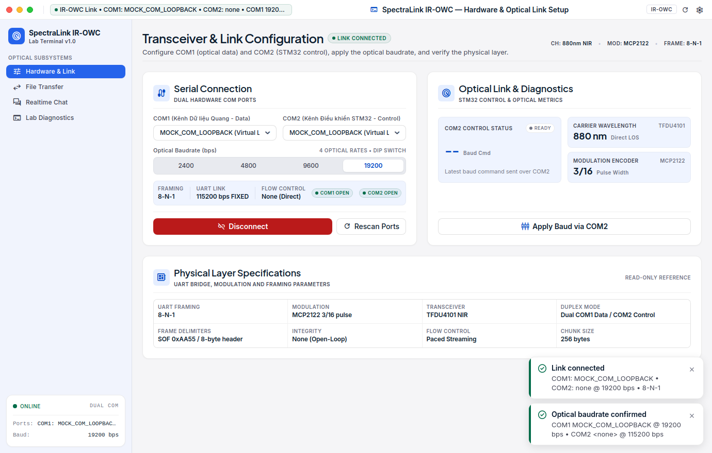

# IR-OWC Lab Terminal (Infrared Optical Wireless Communication)

[]()
[]()
[]()
[]()

Ứng dụng Desktop chuyên dụng điều khiển, giám sát và truyền thông quang không dây hồng ngoại (IR-OWC Lab Terminal) kết nối mạch nhúng **STM32F407 + MCP2122 + TFDU4101** qua hai cổng UART: COM1 dữ liệu quang (`2400`–`19200` bps) và COM2 điều khiển MCU (`115200` bps).

Giao diện đồ họa thiết kế theo phong cách **Apple Modern Precision Light Theme** với kiến trúc **PySide6 (Qt6) + QWebEngineView + QWebChannel**, xử lý đa luồng non-blocking (Worker-Object Pattern) và lưu trữ dữ liệu bền vững bằng **file JSON trên ổ cứng**.

---

## 📸 Giao diện Ứng dụng Thực tế

| Hardware Setup & Link Alignment | Dedicated File Transfer Station |
| :---: | :---: |
|  |  |
| **Realtime Optical Chat Stream** | **Lab Analytics & Diagnostics** |
|  |  |

---

## 🚀 Tính năng Cốt lõi (MVP Features)

1. **Hardware Link Alignment & COM Management (Screen 1):**
   - Tự động nhận diện cổng Serial UART (Windows COM / Linux ttyUSB).
   - Quản lý hai cổng độc lập: **COM1** dữ liệu quang (`2400`–`19200` bps) và **COM2** điều khiển MCU (`115200` bps cố định).
   - Đổi Baudrate quang bằng lệnh hai ký tự `00/01/10/11` gửi qua COM2, sau đó cấu hình lại COM1 mà không đóng ứng dụng.
   - Gauge Dial căn chỉnh góc quang học Azimuth / Elevation và trạng thái khóa sóng quang (CARRIER LOCKED).

2. **Dedicated File Transfer Station (Screen 2):**
   - Hỗ trợ chọn file qua Native Dialog hoặc Kéo thả (Drag & Drop).
   - Động cơ **open-loop paced streaming** tương thích WinForm C#: HEADER, các DATA 256 byte và END; mỗi khung cách nhau `ceil(frameLength * 10 * 1000 / baud) + 10` ms.
   - Không ACK, không CRC, không retransmit. Chunk mất để lại lỗ hổng byte 0 đúng offset; phiên thiếu dữ liệu được báo `PARTIAL`.
   - **Truyền file không giới hạn kích thước**: TX/RX streaming từng chunk xuống đĩa, RAM không tăng theo dung lượng file.
   - **Hủy phiên**: dừng ngay lập tức, watchdog 3 giây kết thúc phiên nhận khi END không đến; AutoSave quyết định giữ file `.partial`.
   - Giám sát tiến độ %, tốc độ thực tế (KB/s), ETA và lưu lịch sử truyền file vào JSON.

3. **Realtime Optical Chat Stream (Screen 3):**
   - Đã được kích hoạt trọn vẹn thông qua cơ chế **Virtual File Envelope**: tự động đóng gói văn bản UTF-8 thành file RAM mang tên `_chat_<timestamp>_<station>.txt`.
   - Truyền nhận trực tiếp hai chiều cực nhanh (< 100 ms) qua kênh quang mà không làm thay đổi 1 bit cấu trúc wire format gốc, đảm bảo tương thích 100% hai chiều với cả WinForm C#.
   - Giao diện bong bóng tin nhắn trực quan, hỗ trợ gõ nhanh bằng Enter và tự động cuộn theo thời gian thực.

4. **Lab Analytics, Diagnostics & CSV Export (Screen 4):**
   - 4 thẻ KPI động: Tốc độ tức thời, Tỷ lệ mất gói, Số frame, Số chunk đã truyền.
   - Bảng Live Packet Sniffer bắt frame thời gian thực với nhãn `FILE_HEADER`, `DATA_CHUNK`, `FILE_END` và trạng thái `OPEN-LOOP`.
   - Xuất dữ liệu chuỗi thời gian ra file `.csv` phục vụ báo cáo thí nghiệm.

---

## 🛠️ Cài đặt & Khởi chạy Nhanh

### Yêu cầu Môi trường:
- Python 3.11+ (Khuyến nghị Python 3.12)
- Trình quản lý gói `uv` (hoặc `pip` trong virtualenv)

```bash
# 1. Cài đặt toàn bộ dependencies
uv sync --extra dev

# 2. Khởi chạy ứng dụng
uv run python -m ir_terminal

# 3. Chạy bộ kiểm thử tự động (274/274 tests passed)
uv run pytest tests/ -v

# 4. Kiểm tra chất lượng mã nguồn
uv run ruff check .
uv run mypy src/ tests/
```

---

## 🧪 Chạy 2 Node trên cùng 1 PC (demo E2E, không cần driver)

Bản build duy nhất hỗ trợ 2 node độc lập qua TCP loopback; Node A chạy broker
in-app nên **không cần cài driver COM ảo** và không cần quyền admin:

```bash
# Dev: Node A (host, tự mở broker 6001/6002) + Node B (client)
./scripts/run_dual_mock.sh

# Hoặc chạy tay:
uv run python -m ir_terminal --instance A --link-role host --auto-connect --window-pos left
uv run python -m ir_terminal --instance B --link-role join --auto-connect --window-pos right
```

Trên Windows bản `.exe`, double-click **`Start_Dual_Demo.cmd`** (được copy cạnh
`IR_OWC_Lab_Terminal.exe`): cửa sổ Node A `[Node A - Host]` và Node B
`[Node B - Client]` tự kết nối, chia trái/phải màn hình.

Đường COM ảo (VSPD/VSPE) chỉ dùng cho nghiệm thu HW. Mỗi board dùng 2 cổng:
COM1 dữ liệu quang và COM2 điều khiển MCU.
`Start_Com_Pair.cmd COM11 COM12 COM13 COM14` (COM1 A, COM2 A, COM1 B, COM2 B).
Khi chạy tay: `--tx-port COM11 --rx-port COM12` (COM1 data, COM2 control).

Các cờ chính: `--instance A|B`, `--link-role off|host|join|auto`, `--link-base-port`,
`--port`, `--tx-port`, `--rx-port`, `--baud`, `--auto-connect`, `--window-pos left|right|normal`,
`--allow-multiple` (bỏ lock), `--broker-only`, `--loss/--latency-ms/--los`.
Mỗi instance có `data/instances/<ID>/` riêng (JSON, transfers, logs, WebEngine cache)
và `app.lock` chống mở trùng.

---

## 📦 Đóng gói Ứng dụng Độc lập (Standalone Executable)

Ứng dụng có thể đóng gói thành một file thực thi độc lập (không yêu cầu cài đặt Python hay thư viện ngoài) thông qua PyInstaller:

```bash
# Đóng gói tự động
uv run python scripts/build_standalone.py

# File thực thi nằm tại:
# dist/IR_OWC_Lab_Terminal/IR_OWC_Lab_Terminal
# Kèm Start_Dual_Demo.cmd và Start_Com_Pair.cmd ở cùng thư mục.
```

### Dữ liệu Runtime (`data/`)

Toàn bộ dữ liệu ghi được đặt cạnh ứng dụng, **không** dùng thư mục home:

```text
<app root>/data/                  # dev: repo root; frozen: cạnh file .exe
├── chat_history.json
├── file_transfers.json
├── telemetry_samples.json
├── settings.json
├── transfers/                    # file nhận qua quang (file tạm .ir_rx_*.part khi đang nhận)
├── logs/                         # log xoay vòng + CSV export
└── instances/<A|B>/              # chỉ khi chạy dual-node, tách biệt hoàn toàn
    ├── chat_history.json / file_transfers.json / settings.json ...
    ├── transfers/  logs/  app.lock
    └── webengine/{cache,storage} # QWebEngineProfile riêng từng node
```

Thư mục được tạo tự động khi khởi động. Biến môi trường `IR_DATA_DIR` có thể ghi đè gốc
`data/` (hữu ích cho bản portable hoặc test).

Thư mục **nhận file** có thể đổi trong *Settings → Default receive directory (Files only)*:
gõ tay hoặc dùng **Browse**, cần thì bấm **Reset to default** để quay về `data/transfers/`.
Chỉ file nhận qua quang đổi chỗ; JSON (chat/lịch sử/telemetry), `settings.json` và `logs/`
**luôn** ở `data/`. Đường dẫn được lưu dạng tuyệt đối (`expanduser().resolve()`), tạo nếu chưa
có, và báo lỗi ngay trên UI nếu không hợp lệ. Mỗi phiên nhận khóa thư mục đích tại thời điểm
bắt đầu nên đổi setting giữa chừng không gây lỗi `EXDEV`.

---

## 📚 Tài liệu Kỹ thuật Tích hợp Phần cứng & Kiến trúc

1. **[Đặc tả giao thức hiện hành](docs/PROTOCOL.md):**
   - Khung `AA 55` + `sequence uint32`, `length uint16`, payload.
   - HEADER/DATA/END, kích thước chunk 256 byte, công thức pacing open-loop.
   - Lệnh đổi Baudrate quang qua COM2 và mã nguồn C mẫu cho STM32F407.

2. **[Kiến trúc & Quy tắc lập trình](docs/ARCHITECTURE.md):**
   - Clean Layered Architecture & Worker-Object Pattern.
   - Strict Typing (Zero `Any`), Google Docstrings (PEP 257), zero inline comment và Subsystem Tagged Logging.

3. **[Index thống nhất + nghiệm thu](docs/README.md) / [Runbook nghiệm thu](docs/ACCEPTANCE.md):**
   - Đối chiếu phạm vi ↔ codebase, quy trình test controller thật và demo từng bước.
