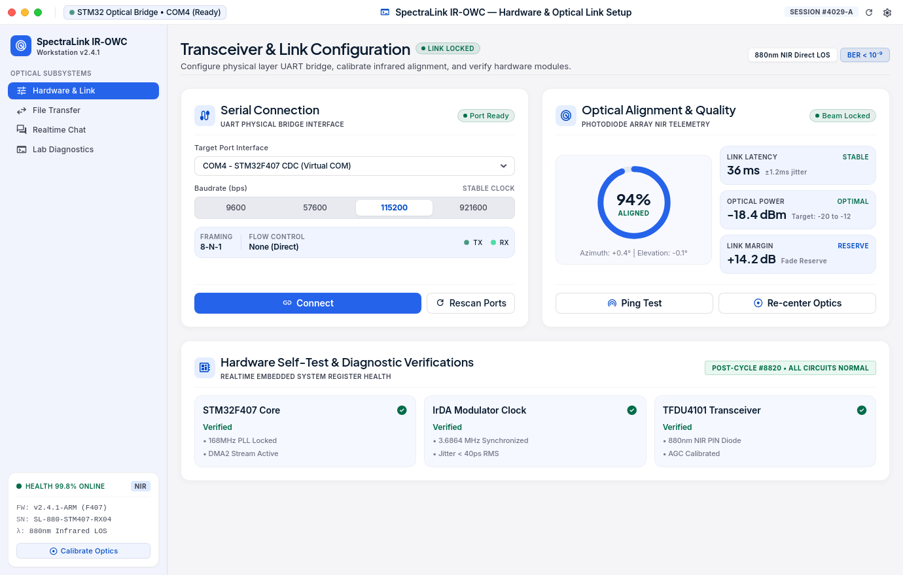
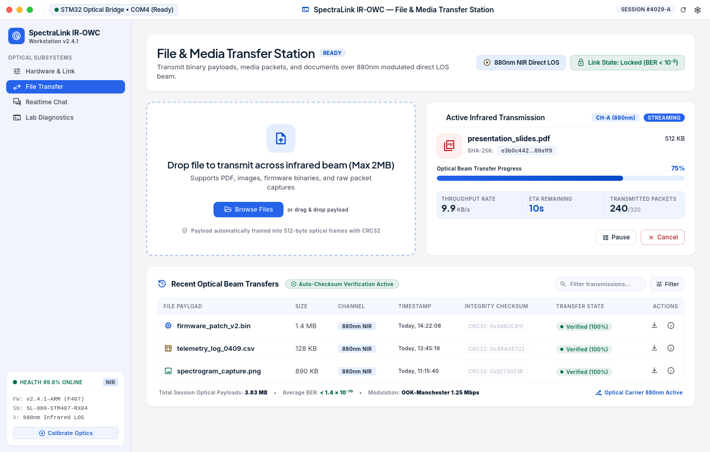
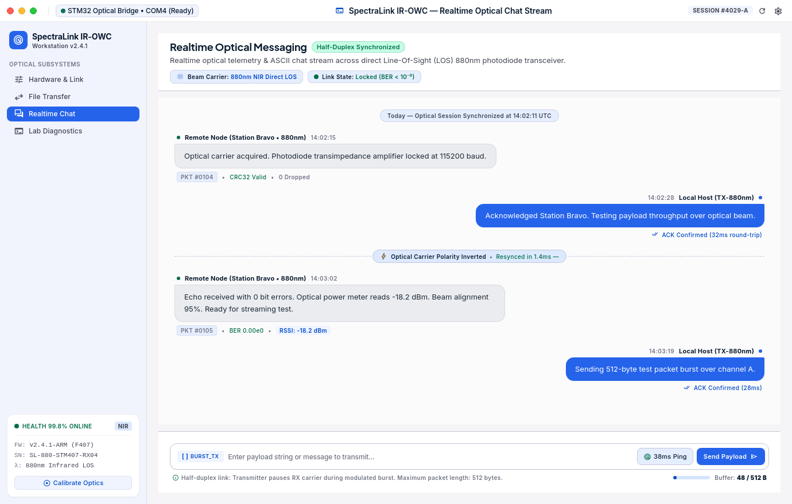
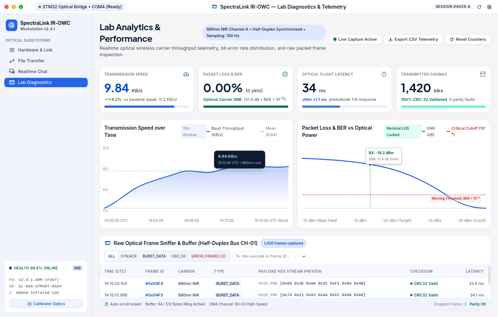

# IR-OWC Lab Terminal (Infrared Optical Wireless Communication)

[]()
[]()
[]()
[]()

Ứng dụng Desktop chuyên dụng điều khiển, giám sát và truyền thông quang không dây hồng ngoại (IR-OWC Lab Terminal) kết nối mạch nhúng **STM32F407 + MCP2122 + TFDU4101** qua giao diện UART @ 115,200 bps.

Giao diện đồ họa thiết kế theo phong cách **Apple Modern Precision Light Theme** với kiến trúc **PySide6 (Qt6) + QWebEngineView + QWebChannel**, xử lý đa luồng non-blocking (Worker-Object Pattern) và lưu trữ dữ liệu bền vững bằng **SQLite**.

---

## 📸 Giao diện Ứng dụng Thực tế

| Hardware Setup & Link Alignment | Dedicated File Transfer Station |
| :---: | :---: |
|  |  |
| **Realtime Optical Chat Stream** | **Lab Analytics & Diagnostics** |
|  |  |

---

## 🚀 Tính năng Cốt lõi (MVP Features)

1. **Hardware Link Alignment & COM Management (Screen 1):**
   - Tự động nhận diện cổng Serial UART (Windows COM / Linux ttyUSB).
   - Đo đạc độ trễ khứ hồi quang học (RTT Ping/Pong roundtrip).
   - Gauge Dial căn chỉnh góc quang học Azimuth / Elevation và trạng thái khóa sóng quang (CARRIER LOCKED).

2. **Dedicated File Transfer Station (Screen 2):**
   - Hỗ trợ chọn file qua Native Dialog hoặc Kéo thả (Drag & Drop).
   - Động cơ **Stop-and-Wait ARQ**: Cắt nhỏ file 240B/chunk, tự động retry khi timeout (250ms), bảo toàn Sequence number.
   - Giám sát tiến độ %, tốc độ truyền thực tế (KB/s), ETA và đối soát băm **CRC-32** toàn vẹn khi kết thúc.
   - Lưu trữ bền vững lịch sử truyền file vào SQLite và ổ cứng.

3. **Realtime Optical Chat Stream (Screen 3):**
   - Soạn và truyền nhận tin nhắn văn bản UTF-8 hai chiều qua chùm tia hồng ngoại.
   - Khung **Raw Frame Inspector** hiển thị Hex Dump và Metadata của gói tin quang nhị phân.
   - Tự động lưu và nạp lại lịch sử chat từ SQLite khi mở ứng dụng.

4. **Lab Analytics, Diagnostics & CSV Export (Screen 4):**
   - 4 thẻ KPI động: Tốc độ tức thời, Tỷ lệ lỗi bit (BER) & mất gói, Độ trễ (Latency RTT), Số khối đã truyền.
   - Bảng Live Packet Sniffer bắt gói tin thời gian thực kèm bộ lọc chip trạng thái.
   - Xuất dữ liệu chuỗi thời gian ra file `.csv` phục vụ báo cáo thí nghiệm.

---

## 🛠️ Cài đặt & Khởi chạy Nhanh

### Yêu cầu Môi trường:
- Python 3.11+ (Khuyến nghị Python 3.12)
- Trình quản lý gói `uv` (hoặc `pip` trong virtualenv)

```bash
# 1. Cài đặt toàn bộ dependencies
uv sync --extra dev

# 2. Khởi chạy ứng dụng
uv run python -m ir_terminal

# 3. Chạy bộ kiểm thử tự động (72/72 tests passed)
QT_QPA_PLATFORM=offscreen uv run pytest tests/ -v

# 4. Kiểm tra chất lượng mã nguồn
uv run ruff check .
uv run mypy src/ tests/
```

---

## 📦 Đóng gói Ứng dụng Độc lập (Standalone Executable)

Ứng dụng có thể đóng gói thành một file thực thi độc lập (không yêu cầu cài đặt Python hay thư viện ngoài) thông qua PyInstaller:

```bash
# Đóng gói tự động
uv run python scripts/build_standalone.py

# File thực thi nằm tại:
# dist/IR_OWC_Lab_Terminal/IR_OWC_Lab_Terminal
```

---

## 📚 Tài liệu Kỹ thuật Tích hợp Phần cứng & Kiến trúc

1. **[Tài liệu Đặc tả Giao thức cho STM32](docs/IOT_STM32_COMMUNICATION_SPECS.md):**
   - Định dạng Frame nhị phân Little-Endian (`0xAA55` SOF, `0x55AA` EOF).
   - Thuật toán CRC-32 chuẩn IEEE 802.3 (`0xEDB88320`).
   - Bảng Opcode, sơ đồ timing, và mã nguồn C mẫu cho vi điều khiển STM32F407.

2. **[Tài liệu Chuẩn Kiến trúc & Quy tắc Lập trình](docs/CONVENTIONS_AND_ARCHITECTURE.md):**
   - Clean Layered Architecture & Worker-Object Pattern.
   - Bộ quy tắc Strict Typing (Zero `Any`), Google Docstrings (PEP 257) và Subsystem Tagged Logging.
