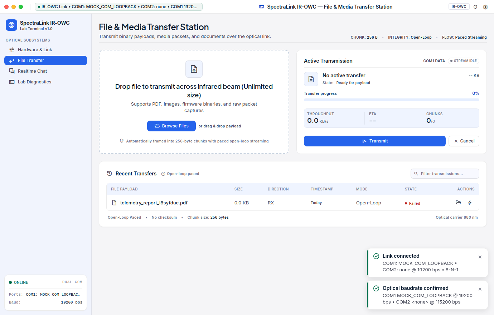
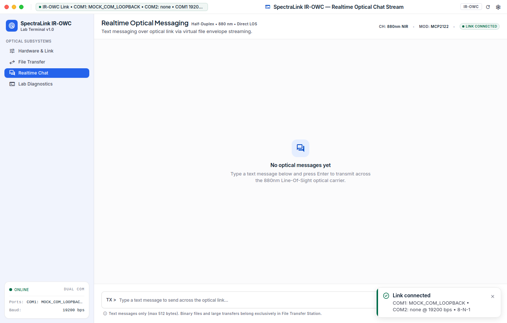
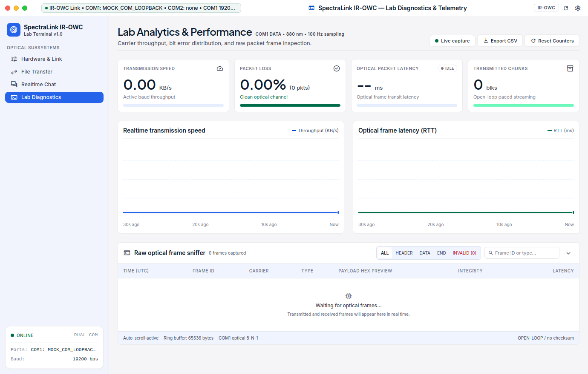

# IR-OWC Lab Terminal (Infrared Optical Wireless Communication)

[]()
[]()
[]()
[]()
[]()

Ứng dụng Desktop chuyên dụng điều khiển, giám sát và truyền thông quang không dây hồng ngoại (IR-OWC Lab Terminal) kết nối hệ thống nhúng **STM32F407 + MCP2122 + TFDU4101** qua hai cổng UART độc lập: **COM1** dữ liệu quang (2400 – 19200 bps) và **COM2** điều khiển vi điều khiển MCU (115200 bps cố định).

Giao diện đồ họa thiết kế theo ngôn ngữ **Apple Modern Precision Light Theme** với kiến trúc hiện đại **PySide6 (Qt6) + QWebEngineView + QWebChannel**, xử lý truyền thông đa luồng phi phong tỏa (Worker-Object Pattern), tương thích 100% giao thức Wire Protocol của WinForm C# và lưu trữ dữ liệu an toàn bằng file JSON trên ổ cứng cục bộ.

---

## 📸 Giao diện Ứng dụng Thực tế

| Hardware Setup & Link Alignment | Dedicated File Transfer Station |
| :---: | :---: |
|  |  |
| **Realtime Optical Chat Stream** | **Lab Analytics & Diagnostics** |
|  |  |

---

## 🚀 Tính năng Cốt lõi Kiến trúc v1.0.0

1. **Hardware Link Alignment & COM Management (Màn hình 1):**
   - Tự động nhận diện danh sách cổng Serial UART (Windows `COMx` / Linux `/dev/ttyUSBx`).
   - Quản lý tách biệt hai kênh truyền thông vật lý:
     - **COM1 (Optical Data):** Vận hành ở tốc độ 2400, 4800, 9600 hoặc 19200 bps (8-N-1).
     - **COM2 (MCU Control):** Vận hành ở tốc độ cố định 115200 bps (8-N-1).
   - Cơ chế đổi Baudrate quang động: Gửi lệnh ASCII hai ký tự `00/01/10/11\r` qua COM2 tới STM32, tự động tái cấu hình COM1 với thời gian chờ an toàn 50 ms mà không làm gián đoạn hay khởi động lại ứng dụng.
   - Trực quan hóa góc xoay quang học (Azimuth / Elevation) và đèn báo trạng thái khóa đường truyền quang (CARRIER LOCKED).

2. **Dedicated File Transfer Station (Màn hình 2):**
   - Hỗ trợ chọn file qua hộp thoại native hoặc Kéo thả (Drag & Drop) trực tiếp vào giao diện.
   - Động cơ **Open-Loop Paced Streaming** tương thích hoàn toàn chuẩn WinForm C#: Trình tự phát `HEADER -> DATA (mỗi chunk 256 byte) -> END`.
   - Cơ chế điều tiết nhịp phát (Pacing Delay) tự động thích ứng theo công thức danh định: `ceil(frameLength x 10 x 1000 ÷ baudrate) + 10 ms`.
   - Thiết kế phi phong tỏa, không ACK, không bắt tay, không CRC ở tầng frame: Dữ liệu nhận ghi trực tiếp vào offset tuyệt đối `sequence x 256` trên file tạm `.part`. Nếu mất gói, dữ liệu vẫn giữ nguyên vị trí và để lại khoảng trống byte 0. Phiên nhận thiếu gói được đánh dấu trạng thái `PARTIAL`.
   - **Streaming trực tiếp xuống đĩa (Direct Disk Streaming):** Bộ nhớ RAM giữ nguyên mức tối thiểu, không tăng theo dung lượng file, hỗ trợ truyền file dung lượng lớn.
   - Watchdog Timeout 3.0 giây tự động chốt hoặc hủy phiên khi tín hiệu quang bị gián đoạn.

3. **Realtime Optical Chat Stream (Màn hình 3):**
   - Hoạt động qua cơ chế **Virtual File Chat Envelope**: Tự động đóng gói nội dung văn bản UTF-8 thành file RAM ảo mang định dạng chuẩn `_chat_<timestamp>_<station>.txt`.
   - Tin nhắn truyền qua luồng khung chuẩn của giao thức WinForm C# mà không làm thay đổi 1 bit cấu trúc wire format gốc.
   - Phía nhận phát hiện tiền tố `_chat_` và đuôi `.txt` sẽ đệm trực tiếp trong RAM và giải mã hiển thị lên giao diện chat trong thời gian < 100 ms.
   - Tương thích hai chiều tuyệt đối: Trạm sử dụng WinForm C# nhận gói tin này vẫn lưu thành file văn bản `.txt` bình thường mà không bị crash hay lỗi logic.

4. **Lab Analytics, Diagnostics & Packet Sniffer (Màn hình 4):**
   - 4 thẻ đo lường KPI thời gian thực: Tốc độ tức thời (KB/s), Tỷ lệ mất gói (Packet Loss %), Tổng số Frame đã bắt, Số Chunk dữ liệu thành công.
   - Bảng Live Packet Sniffer giám sát từng khung truyền trên dây cáp quang, phân loại trực quan: `FILE_HEADER`, `DATA_CHUNK`, `FILE_END` kèm trạng thái `OPEN-LOOP`.
   - Xuất dữ liệu chuỗi thời gian thí nghiệm ra định dạng file chuẩn `.csv` phục vụ nghiên cứu và phân tích số liệu.

---

## 🗺️ Sơ đồ Cấu trúc Mã nguồn (Codebase Structure Map)

Dưới đây là sơ đồ chi tiết toàn bộ cấu trúc thư mục của dự án và vai trò kỹ thuật của từng thành phần:

```text
LabHongNgoai/
├── src/ir_terminal/                 # Mã nguồn chính của ứng dụng Desktop Python
│   ├── __init__.py                  # Định danh package ir_terminal
│   ├── __main__.py                  # Entry point khi chạy lệnh 'python -m ir_terminal'
│   ├── app.py                       # Khởi tạo ứng dụng Qt, QWebEngine, nạp cấu hình và kết nối DI
│   ├── config.py                    # Quản lý cấu hình toàn cục (AppConfig) và nạp tham số CLI
│   │
│   ├── core/                        # Tầng kết nối phần cứng và truyền thông đa luồng
│   │   ├── __init__.py              # Định danh module core
│   │   ├── interfaces.py            # Giao diện trừu tượng tầng truyền tải (ITransport)
│   │   ├── dual_serial_transport.py # Quản lý 2 cổng COM thực (COM1 data, COM2 control), chống lỗi Win32 Error 31
│   │   ├── serial_manager.py        # Bộ điều phối trung tâm trạng thái kết nối và phân phối dữ liệu
│   │   ├── serial_worker.py         # Qt Worker Thread chạy độc lập để đọc/ghi serial phi phong tỏa
│   │   ├── ring_buffer.py           # Bộ đệm vòng hiệu năng cao cho dữ liệu thô nhận từ UART
│   │   ├── socket_transport.py      # Transport TCP giả lập mạng quang hai node qua LAN / Loopback
│   │   ├── link_broker.py           # In-app TCP Broker điều phối kết nối Host/Client không cần cài driver COM ảo
│   │   ├── mock_serial.py           # Giả lập kênh quang vật lý với tỷ lệ rớt gói (loss), độ trễ (latency), che khuất (LOS)
│   │   └── transport_factory.py     # Factory Pattern khởi tạo transport phù hợp theo cấu hình môi trường
│   │
│   ├── protocol/                    # Tầng giao thức truyền thông tương thích WinForm C#
│   │   ├── __init__.py              # Định danh module protocol
│   │   ├── constants.py             # Hằng số wire format (SYNC_MAGIC, SEQ_HEADER, SEQ_END, mã baudrate, delay...)
│   │   ├── packet.py                # Lớp dữ liệu bất biến WinFormPacket đại diện cho khung truyền đã giải mã
│   │   └── framer.py                # Bộ tuần tự hóa (pack) và giải mã (parse_stream) khung truyền, khử nhiễu kênh quang
│   │
│   ├── services/                    # Tầng nghiệp vụ ứng dụng
│   │   ├── __init__.py              # Định danh module services
│   │   ├── file_transfer_service.py # Động cơ truyền nhận file open-loop paced streaming, ghi trực tiếp đĩa .part
│   │   ├── chat_service.py          # Dịch vụ nhắn tin quang qua Virtual File Envelope (_chat_*.txt in-memory)
│   │   ├── telemetry_service.py     # Tính toán thông số đo lường tức thời (throughput, packet loss, frame count)
│   │   └── storage_service.py       # Đọc/ghi bền vững lịch sử chat, lịch sử truyền file và cấu hình ra file JSON
│   │
│   ├── ui/                          # Tầng giao diện người dùng
│   │   ├── __init__.py              # Định danh module UI
│   │   ├── main_window_web.py       # Cửa sổ Qt chính tích hợp Chromium (QWebEngineView), điều phối QWebChannel
│   │   ├── backend_bridge.py        # Cầu nối hai chiều giữa Python QObject và JavaScript WebEngine
│   │   └── web/                     # Mã nguồn giao diện Web tĩnh (Apple Modern Precision Light Theme)
│   │       ├── index.html           # Khung HTML gốc của ứng dụng
│   │       ├── qwebchannel.js       # Thư viện giao tiếp IPC QWebChannel của Qt
│   │       ├── components/          # Các view HTML thành phần (hardware, file, chat, telemetry, modal...)
│   │       ├── assets/              # Phông chữ cục bộ (Inter, Plus Jakarta Sans) và CSS styling
│   │       └── js/                  # Bộ điều khiển giao diện JavaScript (app, chat, file, telemetry, bridge...)
│   │
│   └── utils/                       # Các tiện ích bổ trợ hệ thống
│       ├── __init__.py              # Định danh module utils
│       ├── instance_lock.py         # Khóa file đơn phiên (app.lock) chống chạy trùng tiến trình trên cùng thư mục
│       ├── logger.py                # Hệ thống ghi log gắn thẻ subsystem (LogTag) và định dạng hex dump
│       └── path_helpers.py          # Quản lý đường dẫn runtime an toàn cho cả môi trường dev và frozen .exe
│
├── docs/                            # Tài liệu kỹ thuật dự án
│   ├── PROTOCOL.md                  # Đặc tả chi tiết giao thức quang WinForm C#, công thức nhịp và code mẫu STM32 C
│   ├── ARCHITECTURE.md              # Tài liệu kiến trúc phân tầng, luồng dữ liệu và quy tắc lập trình
│   ├── ACCEPTANCE.md                # Runbook quy trình nghiệm thu hệ thống và kiểm thử phần cứng
│   ├── README.md                    # Mục lục tra cứu tài liệu kỹ thuật
│   ├── WFF.txt                      # Mã nguồn C# WinForm gốc của firmware team dùng làm căn cứ đối chiếu
│   └── screenshots/                 # Ảnh chụp màn hình 4 tab chức năng của ứng dụng
│
├── scripts/                         # Kịch bản tự động hóa, đóng gói và demo
│   ├── build_standalone.py          # Đóng gói ứng dụng thành file thực thi duy nhất bằng PyInstaller
│   ├── build_modular_web.py         # Biên dịch và ghép nối các thành phần Web tĩnh
│   ├── run_dual_mock.sh             # Kịch bản khởi chạy nhanh 2 node độc lập (Host/Client) trên Linux/macOS
│   ├── Start_Dual_Demo.cmd          # File batch khởi chạy nhanh 2 node độc lập trên Windows
│   ├── Start_Com_Pair.cmd           # File batch chạy 2 node qua cổng COM vật lý thật hoặc COM ảo VSPE
│   └── virtual_optical_link.py      # Giả lập liên kết quang vật lý cho môi trường kiểm thử
│
├── tests/                           # Bộ kiểm thử tự động toàn diện (274 test cases đạt 100%)
└── data/                            # Thư mục dữ liệu runtime (tự sinh, nằm cùng thư mục app)
    ├── chat_history.json            # Lưu trữ toàn bộ lịch sử tin nhắn quang
    ├── file_transfers.json          # Lưu trữ lịch sử truyền và nhận file
    ├── telemetry_samples.json       # Lưu trữ mẫu thống kê viễn trắc
    ├── settings.json                # Lưu trữ cấu hình ứng dụng
    ├── transfers/                   # Nơi chứa các file nhận qua đường quang (.part khi đang nhận)
    └── logs/                        # File log xoay vòng và file CSV xuất báo cáo
```

---

## 📡 Hướng dẫn & Các file cốt lõi cho Đội ngũ IoT Firmware (Core Files for IoT Team)

Phần này cung cấp toàn bộ thông số kỹ thuật, định dạng gói tin và các điểm giao tiếp phần cứng thực tế giữa máy tính điều khiển (PC) và bo mạch nhúng để đội ngũ IoT Firmware nắm vững khi phát triển và nạp code cho vi điều khiển STM32.

### 1. Kiến trúc Điểm Giao tiếp Phần cứng

Hệ thống sử dụng bo mạch vi điều khiển **STM32F407 (ARM Cortex-M4)** kết hợp IC mã hóa/giải mã hồng ngoại **Microchip MCP2122** và module thu phát quang **Vishay TFDU4101** (bước sóng đỉnh 880 nm). Máy tính kết nối với mạch nhúng qua **hai cổng UART hoàn toàn độc lập**:

```text
[ Máy tính điều khiển (PC) ]
   │
   ├── Cổng COM1 (Dữ liệu quang) ──> [ TFDU4101 + MCP2122 ] ──> [ STM32F407 USART quang ]
   │   Tốc độ: 2400 - 19200 bps (8-N-1)
   │
   └── Cổng COM2 (Điều khiển MCU) ─> [ STM32F407 USART nạp/lệnh ]
       Tốc độ: 115200 bps cố định (8-N-1)
```

- **COM1 (Optical Data Channel):**
  - Chức năng: Chuyên dùng để truyền và nhận dữ liệu quang (file, chat).
  - Tốc độ hỗ trợ: `2400`, `4800`, `9600` hoặc `19200` bps.
  - Cấu hình khung UART: `8` data bits, `No` parity, `1` stop bit (8-N-1). Flow control: `None`.
  - Thay đổi tốc độ trên COM1 được kích hoạt từ xa thông qua lệnh gửi trên COM2.

- **COM2 (MCU Control Channel):**
  - Chức năng: Kênh điều khiển phần cứng của MCU, nhận lệnh thay đổi Baudrate quang từ PC.
  - Tốc độ cố định: `115200` bps, cấu hình `8-N-1`. Không bao giờ thay đổi baudrate trên COM2.

### 2. Giao thức Đổi Baudrate Quang qua COM2

Khi người dùng chọn Baudrate quang mới trên giao diện PC, phần mềm sẽ gửi một chuỗi mã lệnh ASCII gồm **hai ký tự số** và kết thúc bằng ký tự Carriage Return (`\r`, mã hex `0x0D`):

| Baudrate Quang Đích | Mã Lệnh ASCII | Chuỗi Byte Gửi Trên COM2 (Hex) |
| :---: | :---: | :--- |
| **19200 bps** | `00` | `30 30 0D` |
| **9600 bps** | `01` | `30 31 0D` |
| **4800 bps** | `10` | `31 30 0D` |
| **2400 bps** | `11` | `31 31 0D` |

**Trình tự phối hợp phần cứng:**
1. PC kiểm tra không có phiên truyền file nào đang diễn ra.
2. PC ghi 3 byte lệnh (ví dụ `30 30 0D`) xuống COM2 với tốc độ 115200 bps.
3. Firmware STM32 đọc 2 ký tự số khi gặp `\r`, giải mã và cấu hình lại thanh ghi Baudrate của bộ USART kết nối với MCP2122.
4. PC tạm dừng an toàn trong khoảng **50 ms** (`BAUD_SWITCH_GUARD_MS`) để phần cứng ổn định.
5. PC cấu hình lại tốc độ cổng COM1 tương ứng và xóa sạch bộ đệm (flush buffer).

### 3. Cấu trúc Khung Truyền Trên Dây (Wire Framing Layout)

Giao thức sử dụng chuẩn khung nhị phân đồng bộ của WinForm C# (nguồn chuẩn `docs/WFF.txt`). Mọi số nguyên nhiều byte đều được biểu diễn theo chuẩn **Little-Endian**:

```text
+----------+----------------+----------------+-----------------------+
| SYNC     | SEQUENCE       | LENGTH         | PAYLOAD               |
| 2 bytes  | uint32 LE      | uint16 LE      | LENGTH bytes          |
| AA 55    | 4 bytes        | 2 bytes        | 0 .. 65535 bytes      |
+----------+----------------+----------------+-----------------------+
```

- **SYNC (2 bytes):** Luôn cố định là `0xAA`, `0x55`.
- **SEQUENCE (4 bytes, uint32 LE):** Định danh loại gói tin:
  - `0xFFFFFFFF` (`4294967295`): Gói **HEADER** mở phiên truyền file.
  - `0xFFFFFFFE` (`4294967294`): Gói **END** báo kết thúc phiên truyền file.
  - `0x00000000` đến `0xFFFFFFFD`: Chỉ số thứ tự chunk dữ liệu (**DATA chunk index**, bắt đầu từ 0).
- **LENGTH (2 bytes, uint16 LE):** Độ dài phần payload tính bằng byte (không bao gồm 8 byte tiêu đề).
- **Overhead tiêu đề cố định:** Đúng **8 byte**. Không có trường CRC, không có byte kết thúc khung.

#### Chi tiết Payload của Khung HEADER

```text
+------------------+------------------------+-----------------------+
| nameLength       | fileName               | totalPackets          |
| uint16 LE        | UTF-8, nameLength byte | int32 LE              |
| 2 bytes          | Biến thiên             | 4 bytes               |
+------------------+------------------------+-----------------------+
```

- `nameLength`: Số byte của tên file mã hóa theo chuẩn UTF-8.
- `fileName`: Chuỗi tên file gốc (không chứa ký tự null `\0` kết thúc chuỗi).
- `totalPackets`: Tổng số lượng chunk DATA sẽ gửi, tính bằng công thức: `ceil(fileSize ÷ 256)`. Nếu file rỗng thì `totalPackets = 0`.

#### Chi tiết Payload của Khung DATA và END

- **DATA:** Chứa đúng `256` byte dữ liệu của file tại vị trí tương ứng. Riêng chunk cuối cùng có thể có độ dài nhỏ hơn hoặc bằng 256 byte.
- **END:** Payload rỗng (`LENGTH = 0`).

### 4. Động cơ Open-Loop Paced Streaming & Công thức Tính Độ Trễ (Pacing Delay)

Hệ thống hoạt động theo mô hình **vòng hở (open-loop)** tối ưu cho kênh quang hồng ngoại: Bên gửi không chờ ACK/NACK, không truyền lại gói tin khi lỗi và không sử dụng CRC ở tầng frame. Để bộ đệm UART của STM32 không bị tràn (buffer overflow), bên gửi tự động duy trì nhịp phát (pacing delay) giữa hai khung liên tiếp:

#### Công thức tính Paced Delay:

```text
delay_ms = ceil(frame_length_bytes x 10.0 x 1000 ÷ baudrate) + 10 ms
```

Trong đó:
- `frame_length_bytes`: Tổng độ dài khung truyền trên dây cáp quang, bằng `8 byte tiêu đề + payload_length`. Đối với gói DATA đầy đủ 256 byte thì `frame_length_bytes = 264 byte`.
- `10.0`: Tương ứng 10 bit vật lý truyền trên đường UART cho mỗi byte dữ liệu (gồm 1 start bit + 8 data bits + 1 stop bit theo chuẩn 8-N-1).
- `1000`: Hệ số quy đổi từ giây sang mili-giây.
- `+ 10 ms`: Biên độ trễ an toàn tối thiểu (`PACED_DELAY_SAFETY_MS`) để vi điều khiển kịp xử lý ngắt và ghi bộ đệm.

#### Bảng giá trị trễ danh định chuẩn cho gói DATA 256 byte (khung 264 byte):

| Baudrate Quang | Tính toán thời gian truyền thuần | Biên an toàn | Tổng độ trễ giữa hai khung (delay_ms) |
| :---: | :---: | :---: | :---: |
| **19200 bps** | ceil(264 x 10 x 1000 ÷ 19200) = 138 ms | + 10 ms | **148 ms** |
| **9600 bps** | ceil(264 x 10 x 1000 ÷ 9600) = 275 ms | + 10 ms | **285 ms** |
| **4800 bps** | ceil(264 x 10 x 1000 ÷ 4800) = 550 ms | + 10 ms | **560 ms** |
| **2400 bps** | ceil(264 x 10 x 1000 ÷ 2400) = 1100 ms | + 10 ms | **1110 ms** |

*Ghi chú cho Firmware:* Máy tính có thể trễ thêm một vài mili-giây do lập lịch của hệ điều hành. Vi điều khiển STM32 không được phép đặt timeout quá chặt giữa các byte trong cùng một khung và phải sẵn sàng đón nhận khung mới bất cứ lúc nào.

#### Cơ chế ghi nhận tại phía nhận (RX):
- Phía nhận ghi trực tiếp từng chunk dữ liệu vào file tại vị trí offset tuyệt đối: `offset = sequence x 256`.
- Nếu một chunk bị mất do nhiễu quang, vị trí offset đó trên ổ cứng sẽ tự động là các byte `0x00`. Khi nhận được gói END, file vẫn được lưu đầy đủ kích thước nhưng được gán trạng thái cảnh báo `PARTIAL`.
- Nếu quá `3.0` giây (`RX_INACTIVITY_TIMEOUT_SEC`) mà không có thêm khung dữ liệu nào đến, bộ định thời watchdog phía nhận sẽ tự động kết thúc phiên.

### 5. Cơ chế Virtual File Chat Envelope

Để truyền nhận tin nhắn văn bản tức thời mà không phải sửa đổi định dạng khung truyền của STM32, phần mềm sử dụng kỹ thuật **Bao thư tập tin ảo (Virtual File Chat Envelope)**:
- Bên gửi đóng gói chuỗi văn bản UTF-8 vào bộ nhớ RAM ảo và đặt tên file theo mẫu: `_chat_<YYYYMMDD_HHMMSS>_<StationName>.txt`.
- Gói tin được truyền bằng đúng chuỗi lệnh `HEADER -> DATA -> END` chuẩn của giao thức WinForm.
- Bên nhận khi thấy tên file bắt đầu bằng `_chat_` và đuôi `.txt` sẽ giữ dữ liệu trên RAM và đưa thẳng lên giao diện chat trong thời gian < 100 ms mà không ghi file tạm xuống ổ cứng.

### 6. Bảng Tra cứu Nhanh Chuyên sâu cho Đội ngũ IoT Firmware (Quick Navigation Index)

Mục lục này dành riêng cho các kỹ sư IoT Firmware để tra cứu trực tiếp và nhảy tới chính xác số dòng code trong 6 file cốt lõi của hệ thống:

---

#### 1. `src/ir_terminal/core/dual_serial_transport.py` (Tổng số dòng thực tế: 773 dòng)

Quản lý giao tiếp nối tiếp hai cổng COM phần cứng, cơ chế chuyển mạch Baudrate quang và trung hòa lỗi WinError 31 trên Windows.

| Số dòng bắt đầu | Tên hàm / Lớp / Thuộc tính | Tóm tắt chức năng kỹ thuật |
| :--- | :--- | :--- |
| **Dòng 78** | `_is_windows() -> bool` | Kiểm tra hệ điều hành hiện tại có phải là Windows hay không. |
| **Dòng 83** | `_win32_api() -> _Win32Api | None` | Nạp động thư viện ctypes kernel32 và con trỏ hàm Windows Comm API. |
| **Dòng 147** | `_win32_clear_and_purge_port()` | Xóa sạch lỗi driver và purge hàng đợi I/O trên Windows handle để trung hòa lỗi WinError 31. |
| **Dòng 203** | `_is_retryable_serial_error()` | Nhận diện các ngoại lệ SerialException có thể phục hồi bằng cơ chế retry. |
| **Dòng 210** | `_is_win32_error_31()` | Nhận diện mã lỗi Windows Error 31 (ERROR_GEN_FAILURE). |
| **Dòng 225** | `class ResilientWin32Serial` | Lớp con mở rộng từ serial.Serial xử lý dọn lỗi driver trước khi SetCommState cấu hình DCB. |
| **Dòng 228** | `_reconfigure_port()` | Dọn lỗi driver phần cứng và áp dụng tham số cấu hình DCB (Baudrate/Framing) trên Windows. |
| **Dòng 301** | `class DualSerialTransport` | Lớp transport quản lý đồng thời hai cổng COM vật lý: COM1 (dữ liệu quang) và COM2 (điều khiển STM32). |
| **Dòng 362** | `_create_serial()` | Khởi tạo đối tượng serial với cấu hình chuẩn 8-N-1 và timeout non-blocking. |
| **Dòng 413** | `_open_handles_once()` | Mở đồng thời cặp cổng COM1 và COM2 với kiểm tra tính hợp lệ của tham số. |
| **Dòng 453** | `open()` | Mở kết nối cả hai cổng COM1/COM2 với thuật toán exponential backoff retry tối đa 3 lần. |
| **Dòng 532** | `close()` | Đóng an toàn cả hai cổng COM và giải phóng tài nguyên driver. |
| **Dòng 556** | `write(data)` | Ghi chuỗi byte nhị phân trực tiếp xuống cổng dữ liệu quang COM1. |
| **Dòng 597** | `read(size)` | Đọc dữ liệu từ bộ đệm nhận của cổng dữ liệu quang COM1. |
| **Dòng 634** | `in_waiting` | Thuộc tính trả về số lượng byte sẵn sàng để đọc từ cổng COM1. |
| **Dòng 641** | `flush()` | Xả sạch bộ đệm phát phần cứng của cổng dữ liệu COM1. |
| **Dòng 651** | `send_baud_command(baud)` | Gửi mã lệnh đổi Baud quang 2 ký tự ASCII (00, 01, 10, 11 kèm Carriage Return) qua COM2 tới STM32 và chờ guard time 50 ms. |
| **Dòng 692** | `reconfigure_data_baud(new_baud)` | Tái cấu hình tốc độ Baud của kênh dữ liệu quang COM1 in-place hoặc kích hoạt fallback reopen an toàn. |

---

#### 2. `src/ir_terminal/protocol/constants.py` (Tổng số dòng thực tế: 91 dòng)

Tập trung toàn bộ hằng số kỹ thuật định dạng khung truyền wire-format tương thích 100% WinForm C# và STM32F407.

| Số dòng bắt đầu | Hằng số kỹ thuật | Giá trị chuẩn | Tóm tắt ý nghĩa & vai trò |
| :--- | :--- | :--- | :--- |
| **Dòng 16** | `SYNC_MAGIC` | `b"\xAA\x55"` | Cặp 2 byte đồng bộ cố định (0xAA 0x55) ở đầu mỗi khung truyền quang. |
| **Dòng 21** | `SEQ_HEADER` | `0xFFFFFFFF` | Mã sequence đặc biệt (4294967295) đánh dấu khung tiêu đề mở phiên truyền file. |
| **Dòng 22** | `SEQ_END` | `0xFFFFFFFE` | Mã sequence đặc biệt (4294967294) đánh dấu khung kết thúc phiên truyền file. |
| **Dòng 25** | `PACKET_SIZE` | `256` | Kích thước dữ liệu tiêu chuẩn (256 bytes payload) cho mỗi chunk DATA. |
| **Dòng 28** | `HEADER_OVERHEAD` | `8` | Độ dài tiêu đề khung cố định trên dây (2B Sync + 4B Sequence + 2B Length = 8 bytes). |
| **Dòng 31** | `MAX_HEADER_PAYLOAD_SIZE`| `65535` | Giới hạn dung lượng payload tối đa theo trường độ dài uint16. |
| **Dòng 34** | `BAUD_COMMANDS` | `dict[int, str]` | Bảng ánh xạ tốc độ baud quang sang chuỗi mã ASCII 2 ký tự gửi qua COM2 (19200: "00", 9600: "01", 4800: "10", 2400: "11"). |
| **Dòng 43** | `OPTICAL_BAUDRATES` | `(2400..19200)` | Bộ tuple 4 tốc độ Baud quang được hỗ trợ giữa 2 trạm qua MCP2122 và TFDU4101. |
| **Dòng 48** | `DEFAULT_OPTICAL_BAUDRATE`| `19200` | Tốc độ Baud quang mặc định của kênh COM1 khi khởi động ứng dụng. |
| **Dòng 51** | `CONTROL_BAUDRATE` | `115200` | Tốc độ Baud cố định của kênh điều khiển vi điều khiển STM32 (COM2). |
| **Dòng 59** | `BAUD_COMMAND_TERMINATOR`| `b"\r"` | Ký tự kết thúc lệnh điều khiển baud qua COM2 (Carriage Return '\r' = 0x0D). |
| **Dòng 62** | `BAUD_SWITCH_GUARD_MS` | `50` | Thời gian chờ an toàn (50 ms) sau khi gửi lệnh đổi baud qua COM2 để STM32 chuyển mạch phần cứng. |
| **Dòng 65** | `PACED_DELAY_SAFETY_MS`| `10` | Biên độ an toàn (+10 ms) cộng thêm vào công thức điều tốc Open-Loop Paced Delay. |
| **Dòng 68** | `RX_INACTIVITY_TIMEOUT_SEC`| `3.0` | Thời gian định thời watchdog (3.0 giây) tự động kết thúc hoặc chốt phiên nhận khi mất tín hiệu quang. |
| **Dòng 75** | `RING_BUFFER_CAPACITY` | `65536` | Sức chứa bộ đệm vòng (64 KB) tích lũy dữ liệu thô nhận từ UART tránh tràn RAM. |

---

#### 3. `src/ir_terminal/protocol/packet.py` (Tổng số dòng thực tế: 43 dòng)

Mô hình dữ liệu gói tin bất biến đại diện cho một khung truyền nhị phân hoàn chỉnh nhận từ kênh quang.

| Số dòng bắt đầu | Tên lớp / Thuộc tính | Kiểu trả về | Tóm tắt chức năng kỹ thuật |
| :--- | :--- | :--- | :--- |
| **Dòng 15** | `class WinFormPacket` | `Dataclass` | Lớp dữ liệu bất biến chứa khung truyền đã giải mã: `sequence` (uint32), `length` (uint16), `data` (bytes). |
| **Dòng 31** | `is_header` | `bool` | Kiểm tra gói tin có phải là khung tiêu đề mở phiên truyền file (sequence == 0xFFFFFFFF) hay không. |
| **Dòng 36** | `is_end` | `bool` | Kiểm tra gói tin có phải là khung kết thúc phiên truyền file (sequence == 0xFFFFFFFE) hay không. |
| **Dòng 41** | `is_data` | `bool` | Kiểm tra gói tin có phải là chunk dữ liệu nội dung file (0 <= sequence < 0xFFFFFFFE) hay không. |

---

#### 4. `src/ir_terminal/protocol/framer.py` (Tổng số dòng thực tế: 166 dòng)

Đóng gói khung truyền Little-Endian, tuần tự hóa tiêu đề và phân tích cú pháp dòng byte nối tiếp (stream parsing) khử nhiễu.

| Số dòng bắt đầu | Tên hàm | Tham số chính | Tóm tắt chức năng kỹ thuật |
| :--- | :--- | :--- | :--- |
| **Dòng 30** | `pack_packet()` | `sequence: int, data: bytes` | Đóng gói một khung truyền nhị phân chuẩn WinForm C# gồm 2B Sync Magic + 4B Sequence LE + 2B Length LE + Payload. |
| **Dòng 59** | `pack_header_payload()` | `file_name: str, total_packets: int` | Đóng gói nội dung payload cho khung SEQ_HEADER: 2B nameLength LE + UTF-8 fileName + 4B totalPackets LE. |
| **Dòng 93** | `unpack_header_payload()` | `data: bytes` | Giải mã nội dung payload của khung SEQ_HEADER thành tuple gồm (file_name, total_packets). |
| **Dòng 123** | `parse_stream()` | `buffer: bytearray` | Quét tìm cặp byte đồng bộ SYNC (0xAA 0x55), tự động khử nhiễu kênh quang, bóc tách các khung hoàn chỉnh và bảo toàn byte mẩu cho chu kỳ sau. |

---

#### 5. `src/ir_terminal/services/file_transfer_service.py` (Tổng số dòng thực tế: 1072 dòng)

Động cơ phát file Open-Loop điều tốc (Paced Streaming) và thu nhận ghi trực tiếp xuống đĩa (Direct Disk Streaming).

| Số dòng bắt đầu | Tên hàm / Lớp / Thuộc tính | Tóm tắt chức năng kỹ thuật |
| :--- | :--- | :--- |
| **Dòng 62** | `class TransferState(Enum)` | Định nghĩa các trạng thái vòng đời của phiên truyền nhận: IDLE, SENDING, RECEIVING, COMPLETED, FAILED, ABORTED. |
| **Dòng 73** | `is_active` | Kiểm tra xem hệ thống có đang bận truyền hoặc nhận file hay không. |
| **Dòng 78** | `paced_delay_ms()` | Tính toán thời gian trễ danh định giữa 2 khung liên tiếp: `ceil(length x 10 x 1000 ÷ baud) + 10 ms`. |
| **Dòng 113** | `is_chat_envelope_name()` | Nhận diện tên file có tiền tố `_chat_` và đuôi `.txt` của bao thư tin nhắn ảo. |
| **Dòng 119** | `sanitize_received_name()` | Làm sạch tên file nhận, loại bỏ ký tự lạ và ngăn ngừa tấn công path traversal. |
| **Dòng 153** | `class FileTransferService` | Động cơ điều phối phiên truyền nhận file, tính toán pacing delay và quản lý file tạm .part. |
| **Dòng 429** | `start_transfer()` | Bắt đầu phát file vật lý: mở file, phát gói HEADER và kích hoạt vòng lặp điều tốc. |
| **Dòng 484** | `start_virtual_transfer()` | Khởi động phiên phát file ảo trong bộ nhớ RAM phục vụ gửi tin nhắn chat tức thời. |
| **Dòng 535** | `cancel_transfer()` | Hủy bỏ an toàn phiên truyền hoặc nhận file đang diễn ra. |
| **Dòng 571** | `_send_next_chunk()` | Phát chunk DATA 256 byte tiếp theo và hẹn giờ QTimer với độ trễ paced_delay_ms(). |
| **Dòng 612** | `_send_end()` | Phát khung kết thúc SEQ_END (payload 0 byte) báo hoàn tất phiên gửi file. |
| **Dòng 749** | `_begin_receive()` | Tiếp nhận khung HEADER: giải mã tên file, tạo file tạm `.part` (hoặc BytesIO cho chat) và kích hoạt watchdog timer 3.0s. |
| **Dòng 817** | `_write_chunk()` | Ghi trực tiếp chunk nhận được vào file tạm tại offset tuyệt đối `sequence x 256` và reset watchdog. |
| **Dòng 892** | `_finish_receive()` | Tiếp nhận khung END: kiểm tra độ toàn vẹn, hoàn tất file (đánh dấu PARTIAL nếu thiếu gói) và phát tín hiệu hoàn thành. |
| **Dòng 960** | `_on_rx_timeout()` | Xử lý sự kiện watchdog timer 3.0s: tự động kết thúc hoặc chốt lưu file khi mất tín hiệu quang. |

---

#### 6. `src/ir_terminal/services/chat_service.py` (Tổng số dòng thực tế: 192 dòng)

Dịch vụ nhắn tin quang hai chiều thời gian thực thông qua cơ chế bao thư file ảo (Virtual File Chat Envelope).

| Số dòng bắt đầu | Tên hàm / Lớp / Thuộc tính | Tóm tắt chức năng kỹ thuật |
| :--- | :--- | :--- |
| **Dòng 29** | `class ChatService(QObject)` | Quản lý nhắn tin văn bản quang học thời gian thực qua virtual file envelope. |
| **Dòng 69** | `file_transfer_service` | Thuộc tính truy xuất đối tượng FileTransferService đang kết nối. |
| **Dòng 73** | `set_file_transfer_service()` | Đăng ký dịch vụ FileTransferService để thực thi phiên truyền nhận bao thư file ảo. |
| **Dòng 93** | `send_message(text)` | Đóng gói văn bản UTF-8 thành file ảo `_chat_<timestamp>_<station>.txt` và truyền qua đường quang. |
| **Dòng 140** | `_on_virtual_transfer_completed()` | Nhận trọn vẹn bao thư ảo: giải mã nội dung text UTF-8 từ RAM và phát tín hiệu `message_received` lên UI trong < 100 ms. |
| **Dòng 169** | `_extract_sender()` | Phân tích cú pháp tên file ảo để trích xuất tên định danh trạm phát tin nhắn. |
| **Dòng 186** | `handle_packet(pkt)` | Điểm vào tương thích ngược tiếp nhận và xử lý trực tiếp gói tin WinFormPacket. |

---

### 7. Tài liệu Kỹ thuật Tham khảo Bổ sung cho Firmware

1. **`docs/PROTOCOL.md`**: Đặc tả giao thức hoàn chỉnh nhất, kèm code mẫu C cho STM32F407 (dựng frame, giải mã header, máy trạng thái FSM nhận từng byte và ngắt UART).
2. **`docs/WFF.cs` / `docs/WFF.txt`**: Mã nguồn WinForm C# gốc của firmware team dùng làm căn cứ đối chiếu hành vi thực tế.

---

## 🛠️ Cài đặt & Khởi chạy Nhanh

### Yêu cầu Môi trường:
- Python 3.11+ (Khuyến nghị Python 3.12)
- Trình quản lý gói hiện đại `uv` (hoặc `pip` trong môi trường virtualenv)

```bash
# 1. Cài đặt toàn bộ dependencies (bao gồm dev tools)
uv sync --extra dev

# 2. Khởi chạy ứng dụng trực tiếp
uv run python -m ir_terminal

# 3. Chạy toàn bộ bộ kiểm thử tự động (274/274 tests passed)
uv run pytest tests/ -v

# 4. Kiểm tra chất lượng mã nguồn và kiểu dữ liệu tĩnh
uv run ruff check .
uv run mypy src/ tests/
```

---

## 🧪 Chạy 2 Node trên cùng 1 PC (Demo End-to-End không cần phần cứng)

Ứng dụng tích hợp sẵn in-app TCP Broker cho phép chạy 2 node độc lập (Node A làm Host, Node B làm Client) kết nối qua cơ chế TCP loopback nội bộ mà **không cần cài driver COM ảo** và không đòi hỏi quyền Admin:

```bash
# Kịch bản khởi chạy tự động trên Linux / macOS:
./scripts/run_dual_mock.sh

# Hoặc khởi chạy thủ công từ terminal:
uv run python -m ir_terminal --instance A --link-role host --auto-connect --window-pos left
uv run python -m ir_terminal --instance B --link-role join --auto-connect --window-pos right
```

Trên hệ điều hành Windows, người dùng có thể nhấp đúp trực tiếp vào file **`Start_Dual_Demo.cmd`** (được tự động sao chép cạnh file `IR_OWC_Lab_Terminal.exe`): Cửa sổ Node A `[Node A - Host]` và Node B `[Node B - Client]` sẽ tự động mở song song và kết nối với nhau.

Khi nghiệm thu trên thiết bị thật có cổng COM hoặc cổng COM ảo (VSPE/VSPD), mỗi node sử dụng 2 cổng (COM1 dữ liệu quang, COM2 điều khiển MCU):
```bash
# Chạy với tham số dòng lệnh chỉ định cổng COM:
uv run python -m ir_terminal --tx-port COM11 --rx-port COM12
```

---

## 📦 Đóng gói Ứng dụng Độc lập (Standalone Executable)

Ứng dụng có thể đóng gói thành một file thực thi độc lập (không yêu cầu cài đặt Python hay thư viện ngoài) thông qua PyInstaller:

```bash
# Thực hiện đóng gói tự động
uv run python scripts/build_standalone.py

# Thư mục thực thi sau khi hoàn tất:
# dist/IR_OWC_Lab_Terminal/IR_OWC_Lab_Terminal
# (Kèm sẵn Start_Dual_Demo.cmd và Start_Com_Pair.cmd cùng thư mục)
```

### Quản lý Dữ liệu Runtime (`data/`)

Toàn bộ dữ liệu ghi nhận được lưu trữ cục bộ ngay cạnh file ứng dụng thực thi:

```text
<app root>/data/                  # Môi trường dev: repo root; Môi trường đóng gói: cạnh .exe
├── chat_history.json             # Lịch sử tin nhắn
├── file_transfers.json           # Lịch sử truyền nhận file
├── telemetry_samples.json        # Dữ liệu mẫu đo lường viễn trắc
├── settings.json                 # Cấu hình người dùng
├── transfers/                    # Thư mục lưu file nhận qua quang (.ir_rx_*.part khi đang nhận)
├── logs/                         # File log xoay vòng + file CSV xuất báo cáo
└── instances/<A|B>/              # Tách biệt riêng biệt khi chạy chế độ dual-node
    ├── chat_history.json / file_transfers.json / settings.json ...
    ├── transfers/  logs/  app.lock
    └── webengine/{cache,storage} # Cache và storage của Chromium QWebEngine tách biệt
```

---

## 📚 Tài liệu Kỹ thuật Liên quan

1. **[Đặc tả Giao thức Chi tiết (docs/PROTOCOL.md)](docs/PROTOCOL.md):** Định dạng khung nhị phân `AA 55`, bảng mã lệnh baudrate, quy tắc ghi offset dữ liệu và mã nguồn C mẫu hoàn chỉnh cho STM32F407.
2. **[Kiến trúc Hệ thống (docs/ARCHITECTURE.md)](docs/ARCHITECTURE.md):** Kiến trúc phân tầng sạch (Clean Layered Architecture), mô hình luồng Worker-Object và tiêu chuẩn lập trình Strict Typing.
3. **[Quy trình Nghiệm thu Phần cứng (docs/ACCEPTANCE.md)](docs/ACCEPTANCE.md):** Hướng dẫn từng bước kiểm thử kết nối với mạch phần cứng thực tế và kiểm tra tính năng.
